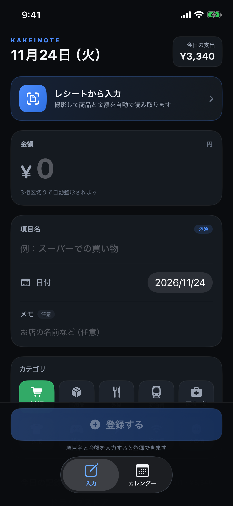
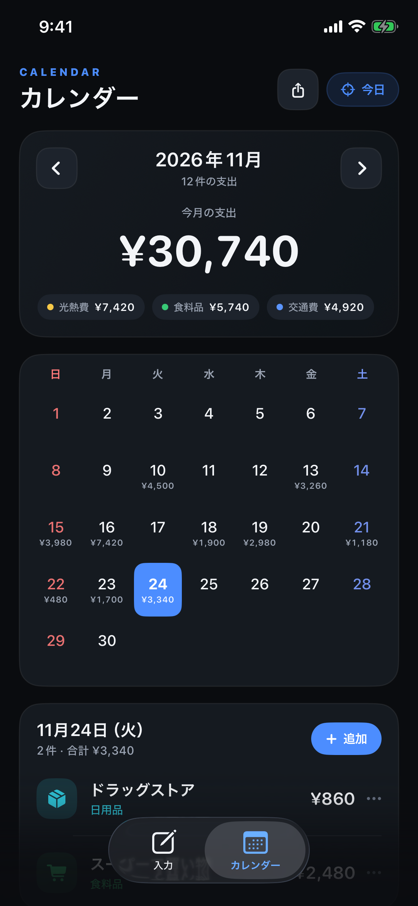
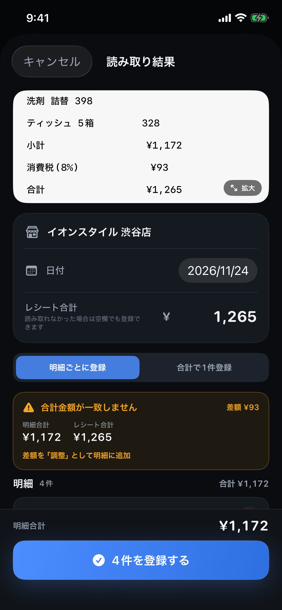

# KakeiNote（家計ノート）

GLM-5.3で生成

レシートを撮影するだけで支出を記録できる、日本語・日本円専用の iPhone 家計簿アプリです。
入力・カレンダー・編集・削除・月間集計まで、すべて端末内で完結します。外部 API や有料サービスは使いません。

<p align="center">
  
  
  
</p>

## 主な機能

### 支出の入力（起動直後の画面）
- 金額・項目名・カテゴリ・日付・メモを入力して登録
- 金額は入力と同時に 3 桁区切りで整形、数字キーボードを使用
- 項目名と金額だけで登録可能。日付は今日が初期値
- 今日の支出と合計をその場で確認
- 登録後もフォームを維持するため、連続入力が可能

### レシート読み取り
1. 「レシートから入力」→ カメラ撮影または写真ライブラリから選択
2. Vision の日本語 OCR（`VNRecognizeTextRequest`）で文字を認識
3. 店舗名・日付・商品名・数量・単価・小計・合計を推定
4. 商品ごとにカテゴリを自動分類
5. 読み取り結果を確認・修正して登録
   - **明細ごとに登録**：商品ごとに 1 件の支出として保存
   - **合計で 1 件登録**：レシート全体を 1 件として保存
   - 明細合計とレシート合計が一致しない場合は警告し、差額を「調整」として追加可能
6. 読み取れない場合は手入力にフォールバック

レシート画像は JPEG として端末内に保存され、支出の編集画面から拡大表示できます。

### カレンダー
- 日曜始まりの月間グリッド、前月・翌月移動、「今日」に戻るボタン
- 各日の支出合計、月間合計、件数、カテゴリ別内訳を表示
- 今日・選択日をハイライト
- 日付をタップするとその日の支出をすべて表示
- その場で追加・編集・削除が可能。操作後は合計が即時更新
- 月をまたぐ移動、未来の月の閲覧にも対応

### CSV 書き出し（バックアップ）
- カレンダー画面の共有ボタンから全支出を CSV で書き出し
- UTF-8 BOM 付きなので Excel や Numbers で日本語がそのまま開ける
- 「ファイルに保存」「AirDrop」「メッセージ」などに渡せる
- 出力項目：日付・項目名・金額・カテゴリ・メモ・店舗名・数量・単価・登録/更新日時
- アプリの削除や機種変更に備えた、手軽なバックアップ手段

### カテゴリ
食料品 / 日用品 / 外食 / 交通費 / 医療・薬 / 衣類 / 娯楽 / 光熱費 / 通信費 / その他

キーワードベースの分類ルールを `CategoryClassifier` に定義しており、ルールを追加するだけで拡張できます。
どのルールにも一致しない商品は「その他」になり、登録前にユーザーが自由に変更できます。

### データ保存
- Core Data（SQLite）に保存。アプリを終了・再起動してもデータは残ります
- 保存項目：ID、日付、項目名、金額、カテゴリ、メモ、レシート画像名、レシートグループ ID、店舗名、数量、単価、作成日時、更新日時
- 日付は必ずその日の 0:00 に正規化し、タイムゾーンや日付境界のずれを防止
- レシート画像は `Application Support/KakeiNote/Receipts` に保存し、最後の参照が消えたときに自動削除

## 動作環境

- iOS 16.0 以上（iPhone 専用・縦向き）
- ダークテーマ固定
- ビルド確認：Xcode 27.2 / iOS 27.2 SDK / iPhone 12 シミュレータ（iOS 26.5）+ iPhone 12 実機（iOS 27.2）
- Swift 5 言語モード

## ビルドと実行

```bash
open KakeiNote.xcodeproj
# Xcode で KakeiNote スキームを選び、iPhone 12 などのシミュレータで実行
```

コマンドラインの場合：

```bash
xcodebuild -project KakeiNote.xcodeproj \
  -scheme KakeiNote \
  -destination 'platform=iOS Simulator,name=iPhone 12,OS=26.5' \
  build CODE_SIGNING_ALLOWED=NO
```

実機へのビルドとインストール（開発チーム設定済み・無料プロファイル）：

```bash
# UDID は「xcrun devicectl list devices」で確認
xcodebuild -project KakeiNote.xcodeproj \
  -scheme KakeiNote \
  -destination 'id=<UDID>' \
  -allowProvisioningUpdates build

xcrun devicectl device install app --device <UDID> \
  ~/Library/Developer/Xcode/DerivedData/KakeiNote-*/Build/Products/Debug-iphoneos/KakeiNote.app

xcrun devicectl device process launch --device <UDID> com.hiroyuki.KakeiNote
```

実機でレシートを撮影する場合は、Xcode の Signing & Capabilities で開発チームを設定してください。
カメラ・写真ライブラリの利用目的は `Info.plist`（ビルド設定で生成）に記載済みです。

## テスト

```bash
# ユニットテスト（61 件）
xcodebuild test -project KakeiNote.xcodeproj -scheme KakeiNote \
  -destination 'platform=iOS Simulator,name=iPhone 12,OS=26.5' \
  -only-testing:KakeiNoteTests CODE_SIGNING_ALLOWED=NO

# UI テスト（機能 4 件 + スクリーンショット 2 件）
xcodebuild test -project KakeiNote.xcodeproj -scheme KakeiNote \
  -destination 'platform=iOS Simulator,name=iPhone 12,OS=26.5' \
  -only-testing:KakeiNoteUITests CODE_SIGNING_ALLOWED=NO
```

UI テストは次の起動引数でデータを分離しています。

| 引数 | 用途 |
| --- | --- |
| `-UITEST_IN_MEMORY` | インメモリの Core Data を使用（テスト間の汚染防止） |
| `-UITEST_SEED` | カレンダー確認用のサンプル支出を投入 |
| `-UITEST_RECEIPT_REVIEW` | カメラを使わずサンプルレシートの確認画面を表示 |

## 構成

```
KakeiNote/
├── KakeiNoteApp.swift          # アプリ起動・外観設定
├── Models/
│   └── Expense.swift           # 支出・カテゴリ・レシート解析結果の値型
├── Persistence/
│   ├── CoreDataStack.swift     # プログラムで定義した Core Data モデル
│   ├── ExpenseRepository.swift # CRUD
│   └── ReceiptImageStore.swift # レシート画像の保存・削除
├── Services/
│   ├── ReceiptOCRService.swift # Vision OCR と画像前処理
│   ├── ReceiptParser.swift     # 日本語レシートの解析ヒューリスティクス
│   ├── CategoryClassifier.swift# キーワードによるカテゴリ分類
│   └── ExpenseCSVExporter.swift# CSV 書き出し（バックアップ）
├── Utilities/
│   ├── CalendarSupport.swift   # 日付境界・月間集計
│   └── Formatters.swift        # 金額・日付の表示
├── ViewModels/
│   └── AppModel.swift          # アプリ全体の状態と CRUD
└── Views/
    ├── RootView.swift          # タブ（入力が最初、カレンダーが 2 番目）
    ├── Entry/                  # 入力画面・レシート読み取り導線
    ├── Calendar/               # 月間カレンダーと日別一覧
    ├── Editor/                 # 追加・編集・削除フォーム
    ├── Receipt/                # 読み取り結果の確認・画像表示・Picker
    └── Components/             # テーマ、カード、カテゴリ選択など
```

## 設計上のポイント

- **値型の `Expense` と Core Data を分離**：UI とテストが扱いやすく、保存形式の変更にも強い構成
- **プログラム指定の Core Data モデル**：`.xcdatamodeld` に依存せず、テストでインメモリ／一時 SQLite を簡単に切り替え
- **OCR の前処理**：画像の向き補正、台形補正（任意）、グレースケール・コントラスト・シャープ化を行ってから認識
- **解析と分類の分離**：`ReceiptParser` は文字列だけを受け取り、`CategoryClassifier` は独立してテスト可能
- **レシート明細のグループ化**：同じレシートから登録した明細は `receiptGroupID` と画像を共有

## 既知の制限

- シミュレータにはカメラがないため、撮影そのものの自動テストはできません。OCR は日本語のレシート画像を生成して自動テストしています。
- 実機（iPhone 12 / iOS 27.2）でのビルド・インストール・起動は確認済みです。カメラ撮影と初回許諾ダイアログは端末上で確認してください。なお無料プロファイルで署名しているため、アプリは約7日で失効します（Xcode から再ビルドで延長）。
- 手書きレシート、複数税率が混在する複雑なレシート、極端に傾いた写真では読み取り精度が下がります。確認画面で修正するか、合計 1 件登録／手入力に切り替えられます。
- レシートの税額行は商品明細に自動配分しません。合計と差額がある場合は「調整」明細として追加できます。
- データの自動バックアップはありません。アプリを削除するとデータも消えるため、定期的に CSV 書き出しでバックアップしてください。
- 動作確認は iOS 26.5 シミュレータと iOS 27.2 実機で行っています。iOS 16 の実機での表示確認は未実施です。

## 開発レポート

実装の経緯、テスト結果、判断したトレードオフは [NIGHT_SHIFT_REPORT.md](NIGHT_SHIFT_REPORT.md) にまとめています。
